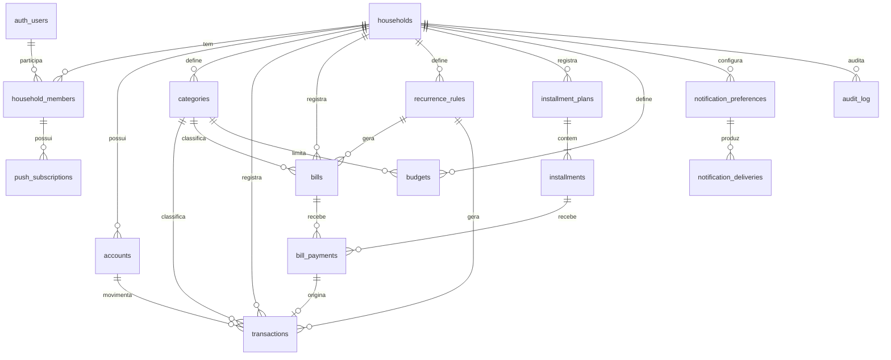

# Fase 0 — Inspeção e planejamento

Data da inspeção: 2026-10-10.

## 1. Estado atual do projeto

- Repositório `jveigaa23/Cashly` **vazio**: nenhum commit, nenhuma branch remota,
  nenhum arquivo além de `.git`. Não havia trabalho anterior a preservar.
- Branch de desenvolvimento: `claude/family-finance-app-ifam9d`.
- Ambiente de desenvolvimento disponível: Node 22, pnpm 10.28, Chromium 141
  (Playwright revision 1194), cliente `psql` 16. Docker **não** está disponível
  no contêiner de desenvolvimento, portanto `supabase start` (stack local via
  Docker) não roda aqui — ver riscos.

## 2. Stack e dependências

Não havia stack preexistente; foi adotada a recomendada no briefing:

| Camada | Escolha | Versão fixada |
| --- | --- | --- |
| Framework | Next.js (App Router, Turbopack, Cache Components) | 16.4.0 |
| UI | React | 19.3.0 |
| Estilo | Tailwind CSS v4 (tokens em CSS) | 4.3.3 |
| Linguagem | TypeScript estrito | 5.9.3 |
| Testes unitários | Vitest + Testing Library + jsdom | 4.1.5 |
| E2E | Playwright (casado com o Chromium do ambiente) | 1.56.1 |
| Banco/Auth (Fase 2) | Supabase PostgreSQL + Supabase Auth + RLS | a definir na Fase 2 |
| Validação (Fase 2+) | Zod | a adicionar quando houver formulários |
| Formulários (Fase 3+) | React Hook Form | a adicionar quando necessário |
| Gráficos (Fase 5) | Recharts | a adicionar na Fase 5 |
| Push (Fase 6) | `web-push` (server-side) | a adicionar na Fase 6 |

Dependências entram somente na fase em que são usadas. As versões ficam
registradas em `pnpm-lock.yaml`.

## 3. Funcionalidades já implementadas

Nenhuma antes desta sessão. Ver seção 10 para o que a Fase 1 entrega.

## 4. Problemas e riscos identificados

| Risco | Impacto | Mitigação |
| --- | --- | --- |
| Sem Docker no ambiente de desenvolvimento | Não há stack Supabase local para testes de RLS | Fase 2: rodar migrações e testes de RLS contra um PostgreSQL de teste (schema `auth` simulado) **ou** contra um projeto/branch Supabase dedicado a testes. Nunca contra dados reais. |
| Credenciais Supabase ausentes | Fase 2 depende de um projeto Supabase | Pedir ao usuário que crie (ou autorize criar) um projeto. Plano gratuito atende ao uso familiar, com limites (pausa por inatividade no plano free). |
| WhatsApp Business API | Exige conta Meta Business verificada, número dedicado, templates aprovados e tem custo por conversa | Fase 6 entrega apenas o adaptador e estados reais (“não configurado”). Ativação depende de decisão e credenciais do usuário. |
| Push no iOS | Só funciona com o app instalado na tela inicial (iOS 16.4+) | Tela de instalação com orientação específica para iPhone; push é opcional. |
| Agendamento no servidor (lembretes) | Precisa de cron que não dependa de página aberta | Fase 6: Vercel Cron ou `pg_cron`/Edge Function do Supabase. Decisão depende da hospedagem. |
| Dados financeiros em cache offline | Vazamento em dispositivo compartilhado | Service Worker **não** armazena HTML nem respostas de dados; apenas assets estáticos versionados e a página offline. |
| `experimental.useOffline` do Next | Repetiria automaticamente Server Actions ao reconectar, podendo duplicar lançamentos | Não habilitado. Mutações falham de forma explícita e o usuário é avisado. |
| Next 16 com Cache Components | APIs dinâmicas (cookies, sessão) precisam de `<Suspense>` | Seguir o guia `authentication-with-cache-components` na Fase 2. |
| Uso por pessoas sem familiaridade técnica | Erros de operação (quitar conta por engano) | Ações financeiras com confirmação explícita, textos claros, botões grandes. |

## 5. Arquitetura proposta

```
src/
  app/                 Rotas (App Router). Server Components por padrão.
    (app)/             Área autenticada (a partir da Fase 2) com shell e navegação.
    manifest.ts        Web App Manifest.
  components/
    ui/                Primitivos acessíveis (Button, Card, StatusBadge, EmptyState, Alert).
    layout/            Shell, navegação, cabeçalho.
    pwa/               Registro do SW, aviso de atualização, instalação, status de conexão.
    theme/             Preferência de tema (claro/escuro/sistema).
  lib/
    format/            Formatação pt-BR (moeda, datas) — sem dependência de UI.
  domain/  (Fase 3+)   Regras financeiras puras: dinheiro, juros, multas, parcelas,
                       recorrências, orçamentos, relatórios. Sem React, sem Supabase.
  server/  (Fase 2+)   Acesso a dados, autorização, Server Actions, adaptadores
                       de notificação (push, WhatsApp). Somente servidor.
supabase/
  migrations/ (Fase 2) Migrações SQL versionadas.
  seed/       (Fase 2) Dados de demonstração, separados dos reais.
public/
  sw.js                Service Worker escrito à mão (sem plugin).
  offline.html         Página autocontida exibida pelo SW sem conexão.
  icons/               Ícones PWA gerados por `scripts/generate-icons.mjs`.
tests/
  e2e/                 Playwright.
```

Princípios:

- **Domínio puro e testável**: cálculos recebem a data de referência como
  parâmetro; nenhum `new Date()` escondido.
- **Dinheiro**: `NUMERIC(14,2)` no banco; no TypeScript, inteiros em centavos
  (`number`, seguro até ~R$ 90 trilhões). Conversão só nas bordas.
- **Servidor como autoridade**: o cliente nunca define `household_id`, papel,
  status ou valores derivados; o servidor valida (Zod) e autoriza, e o banco
  reforça com RLS e constraints.
- **Operações multi-registro atômicas** via funções PostgreSQL (RPC) com
  `SECURITY INVOKER` e checagem de vínculo à família.
- **Integrações externas** (push, WhatsApp) atrás de interfaces de canal; sem
  credenciais, o canal reporta `not_configured` em vez de simular sucesso.

## 6. Modelo de dados inicial

Todas as tabelas: `id uuid` (PK, `gen_random_uuid()`), `created_at` e
`updated_at timestamptz`, RLS habilitada. Valores monetários `numeric(14,2)`
com `check (valor >= 0)` onde aplicável. Vencimentos e datas de competência
`date`; eventos `timestamptz`.



| Tabela | Papel | Campos principais / regras |
| --- | --- | --- |
| `households` | Família | `name`, `timezone` (padrão `America/Sao_Paulo`), `archived_at` |
| `household_members` | Vínculo usuário↔família | `user_id` → `auth.users`, `role` (`owner`,`member`), `display_name`; `unique(household_id,user_id)` |
| `accounts` | Contas/carteiras de registro (não bancárias) | `name`, `kind` (`checking`,`savings`,`cash`,`other`), `opening_balance`, `archived_at` |
| `categories` | Categorias | `name`, `kind` (`income`,`expense`), `archived_at`; `unique(household_id,kind,lower(name))` |
| `transactions` | Receitas e despesas **efetivas** ou **previstas** | `type` (`income`,`expense`), `status` (`planned`,`confirmed`,`canceled`), `amount>0`, `occurred_on date`, `category_id`, `account_id`, `payment_method` (texto descritivo), `nature` (`fixed`,`variable`), `bill_payment_id unique null` (evita dupla contagem), `recurrence_rule_id` + `recurrence_date` com `unique` (idempotência) |
| `bills` | Contas a pagar | `name`, `description`, `category_id`, `original_amount`, `due_date`, `status` (`pending`,`partially_paid`,`paid`,`canceled`; “vencida” é **derivada** de `due_date` < hoje e saldo > 0), `fine_percent`, `interest_rate`, `interest_period` (`daily`,`monthly`), `interest_basis` (`original`,`outstanding`), `recurrence_rule_id` + `recurrence_date` `unique` |
| `bill_payments` | Pagamentos manuais (inclusive parciais) de contas e parcelas | `bill_id` **ou** `installment_id` (check exclusivo), `paid_on date`, `amount>0`, `principal_part`, `charges_part`, `canceled_at` |
| `recurrence_rules` | Regras de recorrência | `target` (`bill`,`income`,`expense`), `frequency` (`monthly`,`weekly`,`yearly`), `day_of_month`, `starts_on`, `ends_on`, `template jsonb` validado no servidor |
| `installment_plans` | Compras parceladas, empréstimos | `kind`, `description`, `total_amount`, `installment_count>0`, `first_due_date`, `interest_method` (`none`,`simple_monthly`,`price`*), `interest_rate`, `status` (`active`,`finished`,`canceled`) |
| `installments` | Parcelas | `plan_id`, `number`, `due_date`, `expected_amount`, `status`; `unique(plan_id,number)` (geração idempotente) |
| `budgets` | Limites mensais | `month date` (1º dia), `category_id null` (= geral), `limit_amount`, `alert_percent` (padrão 80); `unique(household_id,month,category_id)` com `nulls not distinct` |
| `notification_preferences` | Preferências por família e destinatário | `member_id`, `channel` (`in_app`,`push`,`whatsapp`), `event` (`due_soon`,`overdue`,`installment`,`budget`), `enabled`, `days_before` |
| `notification_deliveries` | Registro de envios | `channel`, `event`, `reference_id`, `status` (`pending`,`sent`,`failed`,`not_configured`,`read`), `error_code`; **sem conteúdo financeiro**; `unique(member_id,channel,event,reference_id,scheduled_for)` |
| `push_subscriptions` (justificada) | Inscrição Web Push por dispositivo | `member_id`, `endpoint unique`, `p256dh`, `auth`, `expired_at` |
| `audit_log` (justificada) | Histórico de alterações e cancelamentos | `entity`, `entity_id`, `action`, `actor_id`, `diff jsonb`, `at timestamptz`; somente inserção (sem update/delete via RLS) |

\* `price` (tabela Price) somente se confirmado como necessário; a Fase 4
inicia com `none` e `simple_monthly`, conforme o briefing.

Exclusão e arquivamento: registros financeiros **não são apagados** pela
aplicação; usam `status = canceled` (lançamentos, contas, pagamentos) ou
`archived_at` (contas, categorias, famílias). Exclusão física só por
procedimento administrativo documentado.

Dados de demonstração: `supabase/seed/demo.sql`, aplicado apenas em família
marcada como demonstração, nunca no ambiente de produção.

## 7. Plano de execução

Cada fase termina com lint, typecheck e testes passando, e com relatório de
arquivos alterados, decisões e próximos passos.

### Fase 1 — Fundação, identidade visual e PWA (sem credenciais)
- [x] Next.js + TypeScript estrito + Tailwind v4 + ESLint.
- [x] Tokens visuais (claro/escuro), primitivos acessíveis.
- [x] Tema claro/escuro/sistema com persistência e sem “flash”.
- [x] Shell mobile-first: navegação inferior no celular, lateral no desktop.
- [x] Formatação pt-BR de moeda e datas, com testes.
- [x] Manifest, ícones (incl. maskable e Apple), Service Worker seguro,
      página offline, aviso de nova versão, orientação de instalação,
      indicador de conexão.
- [x] Cabeçalhos de segurança.
- [x] Vitest e Playwright configurados com testes da fundação.
- [x] README, `.env.example`, documentação de arquitetura e PWA.

### Fase 2 — Banco, autenticação e segurança — concluída (ver docs/supabase.md)
- Migrações SQL de todas as tabelas, constraints, índices e RLS.
- Funções auxiliares `is_household_member(household_id)`.
- Supabase Auth (e-mail + senha, recuperação por e-mail), sessões via
  `@supabase/ssr` e `proxy.ts`.
- Onboarding: criar família / convite por e-mail para o segundo membro.
- Testes de RLS (acesso entre famílias negado) em banco de teste isolado.
- Aceite: usuário de outra família recebe 0 linhas/erro em todas as tabelas.

### Fase 3 — Contas, despesas, receitas e pagamentos manuais — concluída
- Módulo `domain/money` (centavos, arredondamento half-even/half-up documentado).
- CRUD com Server Actions validadas (Zod); cancelamento em vez de exclusão.
- Pagamento explícito com confirmação, parcial ou total, em RPC atômica que
  cria `bill_payments` + `transactions` vinculada (sem dupla contagem).
- Histórico (`audit_log`), filtros, busca, ordenação.

### Fase 4 — Juros, multas, recorrências e parcelas
- `domain/charges`: juros simples diários/mensais, multa única, base de
  cálculo, interrupção na quitação, pagamentos parciais, arredondamento.
- `domain/installments`: geração idempotente, resíduo de centavos na última
  parcela (documentado), saldo devedor.
- `domain/recurrence`: fim de mês (dia 31 → último dia), bissexto, idempotência
  por `(rule_id, date)`.

### Fase 5 — Dashboard, orçamento, gráficos e relatórios
- Agregações em SQL/RPC validadas contra registros de origem.
- Dashboard separando saldo registrado, obrigações pendentes e previsões.
- Recharts com alternativa textual/tabela; CSV e impressão.

### Fase 6 — Notificações
- Avisos internos; Web Push com VAPID e inscrições por dispositivo;
  adaptador WhatsApp com estado `not_configured` até haver credenciais;
  agendador server-side.

### Fase 7 — Testes de integração, E2E, segurança, a11y e responsividade
### Fase 8 — Produção, documentação final e implantação

## 8. Comandos de teste disponíveis

| Comando | O que faz |
| --- | --- |
| `pnpm lint` | ESLint (regras do Next + TypeScript) |
| `pnpm typecheck` | Gera tipos de rotas (`next typegen`) e roda `tsc --noEmit` |
| `pnpm test` | Vitest (unitários e de componentes), execução única |
| `pnpm test:watch` | Vitest em modo watch |
| `pnpm build` | Build de produção |
| `pnpm test:e2e` | Playwright contra o build de produção (`next start`) |
| `pnpm icons` | Regera os ícones PWA (`scripts/generate-icons.mjs`) |
| `pnpm check` | Lint + typecheck + testes unitários |

## 9. Variáveis de ambiente e serviços externos

| Variável | Fase | Onde | Observação |
| --- | --- | --- | --- |
| `NEXT_PUBLIC_SUPABASE_URL` | 2 | cliente+servidor | URL do projeto |
| `NEXT_PUBLIC_SUPABASE_ANON_KEY` | 2 | cliente+servidor | chave pública (protegida por RLS) |
| `SUPABASE_SERVICE_ROLE_KEY` | 6 | **somente servidor** | apenas para o agendador de notificações |
| `NEXT_PUBLIC_VAPID_PUBLIC_KEY` | 6 | cliente | chave pública VAPID |
| `VAPID_PRIVATE_KEY` | 6 | **somente servidor** | |
| `VAPID_SUBJECT` | 6 | servidor | `mailto:` do responsável |
| `CRON_SECRET` | 6 | servidor | protege o endpoint do agendador |
| `WHATSAPP_*` | 6 (opcional) | **somente servidor** | token, phone number id, templates |

Serviços externos e custos potenciais:

- **Supabase** — plano gratuito suficiente para uma família (projetos
  gratuitos podem ser pausados por inatividade; backups automáticos diários
  só nos planos pagos). Decisão pendente do usuário.
- **Hospedagem (Vercel ou similar)** — plano Hobby gratuito atende uso
  pessoal/familiar; HTTPS incluso. Cron no plano Hobby tem limitações de
  frequência. Decisão pendente.
- **WhatsApp Business Platform** — cobrança por conversa/template, conta
  Meta Business verificada. Opcional, decisão pendente.
- **Web Push** — gratuito (serviços de push dos navegadores).

## 10. Critérios de conclusão da Fase 1

1. `pnpm lint`, `pnpm typecheck`, `pnpm test`, `pnpm build` e
   `pnpm test:e2e` passam.
2. `/manifest.webmanifest` válido: `name`, `short_name`, `start_url`,
   `display: standalone`, `theme_color`, ícones 192 e 512 (incluindo
   `maskable`).
3. Service Worker registra-se em produção, controla a página e **não**
   armazena respostas HTML/dados; sem rede, navegações exibem a página
   offline com aviso claro.
4. Nova versão do SW gera aviso “Atualizar” que só recarrega após ação do
   usuário.
5. Tema claro/escuro/sistema alterna, persiste após recarregar e não pisca.
6. Layout utilizável em 360 px de largura sem rolagem horizontal; alvos de
   toque ≥ 44 px; foco visível; navegação por teclado.
7. Moeda formatada como `R$ 1.234,56` e entrada `1.234,56` convertida para
   centavos, com testes.
8. Nenhuma tela exibe dados financeiros simulados como se fossem reais: as
   seções ainda não implementadas informam explicitamente a fase em que
   chegam.

## Decisões após a Fase 1

- **Supabase**: projeto `cashly` criado na organização do usuário, plano
  gratuito, região São Paulo (autorizado em 10/10/2026).
- **Login**: contas individuais por pessoa, ligadas à mesma família (aprovado).
- **Hospedagem e APK (recomendação, a confirmar na Fase 8)**:
  - Hospedar o app na **Vercel (plano Hobby, gratuito, HTTPS)**.
  - Gerar um **APK Android por TWA (Trusted Web Activity)** com Bubblewrap ou
    PWABuilder: um app Android “de verdade” que abre o Cashly hospedado em tela
    cheia, com ícone na gaveta de apps do Samsung. Exige publicar
    `/.well-known/assetlinks.json` e guardar a chave de assinatura do APK.
  - Distribuição: instalar o APK direto no celular (permitir “instalar apps
    desconhecidos” uma vez) ou publicar na Play Store (taxa única de US$ 25).
  - Alternativa sem APK: “Instalar app” no Chrome/Samsung Internet já cria um
    ícone de app no Samsung (WebAPK).
  - O APK continua dependendo do app hospedado: atualizações chegam sem
    reinstalar.
